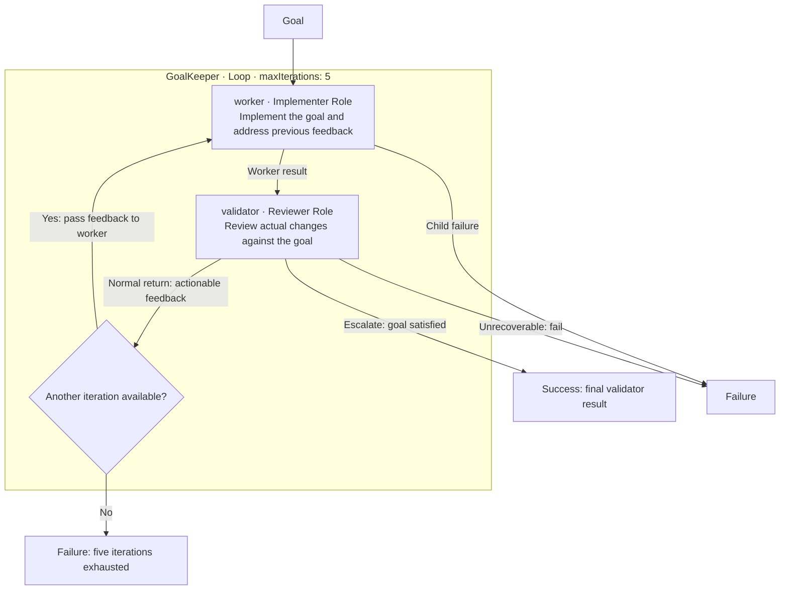

# GoalKeeper pack

Give GoalKeeper a coding task. Its worker implements the change, then an
independent validator reviews the actual files and tests. Review feedback goes
back to the worker until the validator accepts the result or the Loop reaches
its five-iteration limit.

## Workflow



Each iteration runs worker then validator. The worker receives the original
goal and previous validator feedback; the validator receives the goal and
worker result. Only the validator child has `canEscalate: true`: escalation
completes the Loop, while a normal return continues it. Exhausting five
iterations fails the run. Each Role visit starts a fresh provider session;
the root run's shared state carries results and feedback between visits.

## Pack contents

The pack bundles one workflow and both Roles it needs:

| Resource | Responsibility |
| --- | --- |
| [GoalKeeper Loop](workflows/goalkeeper.md) | Runs implementation and validation, carries feedback, and bounds iteration. |
| [Implementer Role](roles/implementer.md) | Makes a bounded change and runs relevant checks; workflow alias: `worker`. |
| [Reviewer Role](roles/reviewer.md) | Reviews the actual changes without editing files; workflow alias: `validator`. |

The resource namespace is `goalkeeper`. The workflow references its bundled
`goalkeeper/roles/implementer` and `goalkeeper/roles/reviewer`; it needs no shared
example Roles.

## Install Callee

Install [Node.js with npm](https://nodejs.org/en/download), then install the
Callee CLI:

```bash
npm install --global @baldaworks/callee@latest
callee --version
```

Alternatively, use the [Go installation instructions](../../docs/getting-started/installation.md#install-from-go-source).

Importing the pack also requires `git` on `PATH`. Both bundled Roles use Codex,
so running the workflow requires an installed, authenticated Codex CLI and a
controlling terminal. See [provider prerequisites](../../docs/guides/acp-providers.md).
Installing Callee and importing the pack do not install or authenticate Codex.

## Install the pack in your project

Run this from the root of the project you want GoalKeeper to work on:

```bash
callee agent import baldaworks/callee \
  --path examples/goalkeeper \
  --prefix goalkeeper
```

The command installs three editable resources in your project's catalog:

```text
.callee/
└── goalkeeper/
    ├── roles/
    │   ├── implementer.md
    │   └── reviewer.md
    └── workflows/
        └── goalkeeper.md
```

Keep `--prefix goalkeeper`: it matches the workflow's Role references. The
README is documentation and is skipped during import. Existing destination
files are preserved; add `--force` only when you intend to replace your local
copies with the repository versions. See [import behavior](../../docs/guides/importing-agents.md).

## Inspect and run

From the same project root, inspect the installed workflow and its resolved
Roles before running it:

```bash
callee agent view goalkeeper/workflows/goalkeeper
callee agent run goalkeeper/workflows/goalkeeper \
  --message "Implement the requested change and verify it meets the goal."
```

Replace the message with your task. The worker can edit project files and run
checks. The reviewer retains `ask` permission mode and is instructed to inspect
without editing. A successful run returns the validator's final result prefixed
with `GoalKeeper finished with result:`.

## Inspect the checked-in example

For contributors working in a checkout of the Callee repository, validate the
physical resources and inspect the pack without importing it:

```bash
callee agent validate examples/goalkeeper/workflows/goalkeeper.md
callee agent validate examples/goalkeeper/roles/implementer.md
callee agent validate examples/goalkeeper/roles/reviewer.md
callee --agent-root examples agent view goalkeeper/workflows/goalkeeper
```

Use `examples` as the catalog root because the checked-in resource references
include the `goalkeeper` namespace.
